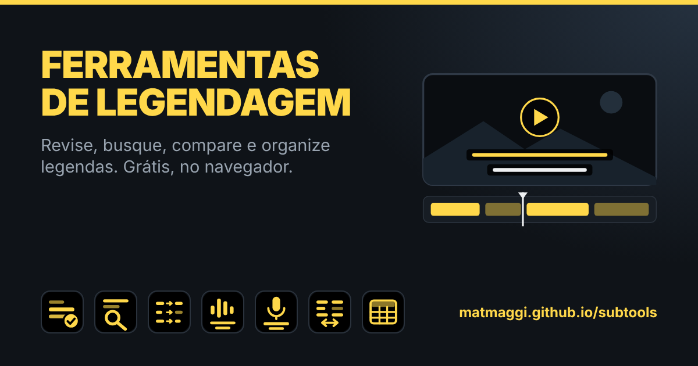

# SubTools · Ferramentas de legendagem

**Ferramentas gratuitas para revisar, buscar, comparar e organizar legendas, direto no navegador.**

O SubTools é a página inicial de um conjunto de ferramentas criadas para o dia a dia de quem traduz e revisa legendas. Cada ferramenta é uma página independente: não precisa instalar nada, basta abrir no navegador.

👉 **Acesse:** [matmaggi.github.io/subtools](https://matmaggi.github.io/subtools/)

## Ferramentas

| Ferramenta | O que faz | Tipo |
|---|---|---|
| [**RevTitles**](https://matmaggi.github.io/revtitles/) | Verificação ortográfica, padronização de legendas e revisão por IA | Revisão |
| [**SearchTitles**](https://matmaggi.github.io/searchtitles/) | Buscador de termos em várias legendas, com contexto e tradução | Busca |
| [**LexiSub**](https://matmaggi.github.io/lexisub/) | Glossário inteligente de nomes e termos (KNP) | Glossário |
| [**Ler-gendas**](https://matmaggi.github.io/ler-gendas/) | Ouça sua legenda em voz alta e marque o que corrigir | Áudio |
| [**TranscriAÇÃO**](https://matmaggi.github.io/TranscriACAO/) | Transcreva áudio ou vídeo em legendas prontas para editar | Transcrição |
| [**Comparador de Legendas**](https://matmaggi.github.io/comparadordelegendas/) | Compare as mudanças de duas versões de uma legenda em detalhes | Comparação |
| [**ExcelTitles**](https://matmaggi.github.io/exceltitles/) | Template e tradução alinhados lado a lado em uma planilha | Planilha |

Cada ferramenta tem o próprio repositório, com um README completo, e um botão **?** na página que explica todas as funcionalidades.

## Formatos de legenda

As ferramentas trabalham com os formatos mais usados em plataformas de streaming e estúdios: **SRT, DFXP, PXTT, TTML e TTAL**, além de VTT e TXT na exportação do TranscriAÇÃO.

## Privacidade

- As legendas são lidas e processadas no seu navegador. Nada é enviado para servidores do SubTools.
- Os recursos de IA (no RevTitles, no LexiSub e no TranscriAÇÃO) e a verificação ortográfica online do RevTitles são opcionais. Quando você usa um deles, o texto ou o áudio vai apenas para o serviço que você escolheu.
- As chaves de API só ficam guardadas no navegador se você marcar essa opção.

## Página inicial

- Lista de todas as ferramentas, com ícone, descrição e etiqueta de tipo.
- Filtro de busca que ignora acentos.
- Botão **?** em cada ferramenta, com um resumo do que ela faz.
- Prévia com imagem ao compartilhar o link (WhatsApp, LinkedIn, Facebook, X, Telegram).

Para adicionar uma ferramenta à página, basta incluir um item na lista `TOOLS` no código do `index.html`.

## Créditos

Ideia desenvolvida por [Matheus Maggi](https://www.matheusmaggi.com/) e executada com o auxílio do Claude.

O SearchTitles é uma adaptação da ferramenta [Subtricks](https://subtricks.vercel.app/), desenvolvida por [Pedro Pereira](https://linktr.ee/pedrospj).

## Apoie

Achou as ferramentas úteis? Faz um PIX! **5a08fa27-b8f4-4935-9857-6b03fb63248a**
